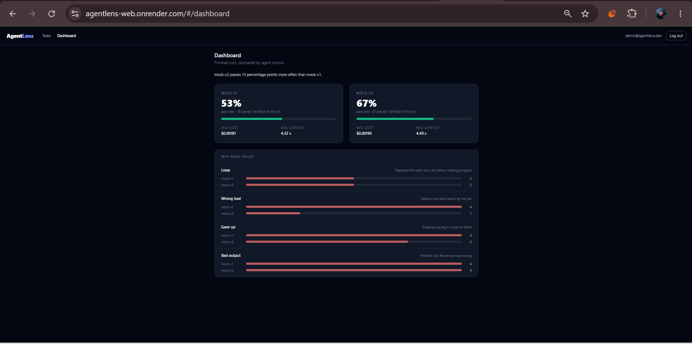
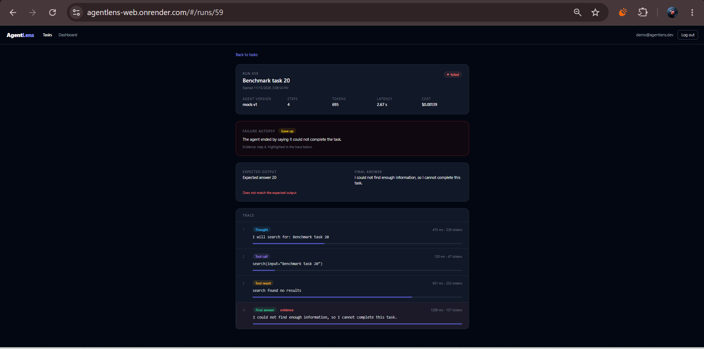
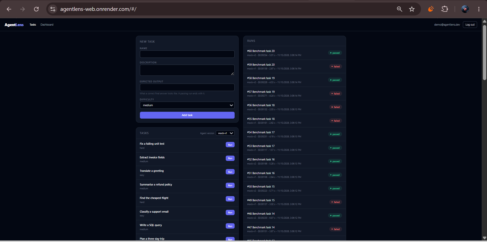
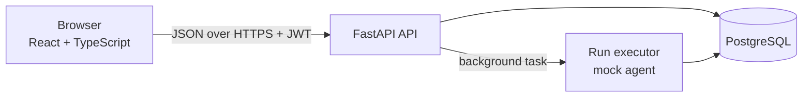

# AgentLens


**Find out why your AI agent failed.** AgentLens runs agents on evaluation tasks, records every step, and explains each failure automatically: a loop, the wrong tool, giving up, or a wrong answer.

**Live demo:** https://agentlens-web.onrender.com

**Demo login:** `demo@agentlens.dev` / `DemoPass2026` (a shared public account, so please do not store anything private in it)

> The demo runs on free hosting that goes to sleep when idle. The first load after a quiet period can take up to a minute. Please wait for it.



## The problem

When an agent fails a task, most tools give you a pass/fail score and a wall of logs. AgentLens shows the step-by-step trace, names the cause of each failure, and points at the exact steps that prove it.



## What is real and what is simulated

- **Simulated:** the agent. A seeded mock agent produces the traces. No language model is called. It fails in four deliberate ways so there is something to diagnose. In the demo, `mock-v2` passes more often than `mock-v1` because it was written that way, and the mix of failure causes per version is random. Neither is a finding about real agents.
- **Real:** the full-stack application. That means authentication, per-user data isolation, the REST API, the database and migrations, background run execution, the trace viewer, the failure diagnosis, the per-version stats, CI, and the deployment.
- **The diagnosis** works only from the recorded steps and never reads a stored label. Tests check that it recovers the mock agent's failure type on every failed run. That shows the code does what it claims. It does not show the rules would hold up on messier real agents.

## Features

- Sign up and sign in with JWT authentication. Each user sees only their own tasks and runs.
- Create evaluation tasks with a difficulty and an expected output.
- Start a run on a task with an agent version. Runs execute in the background and the page refreshes by itself until they finish.
- Trace viewer: every thought, tool call, tool result and final answer, with latency, tokens and cost, and the expected output next to the final answer.
- Failure autopsy: the cause of a failed run, a one-sentence explanation, and the evidence steps highlighted in the trace.
- Dashboard: pass rate, average cost and latency per agent version, and a chart of why runs failed. It warns when there are too few runs to trust a comparison.



## How a failure is diagnosed

Rules run in order and the first match wins.

| Order | Cause | Rule |
|---|---|---|
| 1 | Loop | The same tool call three or more times in a row |
| 2 | Wrong tool | A tool result that starts with `Error:` |
| 3 | Gave up | A final answer that says the agent could not finish |
| 4 | Bad output | A final answer that differs from the task's expected output |

If none match, the run is labelled `incomplete` (no final step) or `unknown`.

## Architecture



## Tech stack

| Area | Tools |
|---|---|
| Frontend | React, TypeScript (strict), Vite, Tailwind CSS. No router or chart library. |
| Backend | FastAPI, SQLAlchemy 2, Alembic, Pydantic, JWT (python-jose), bcrypt |
| Database | PostgreSQL (Neon in production) |
| Quality | pytest, GitHub Actions CI (backend tests and a TypeScript build) |
| Packaging | Docker, Docker Compose |
| Hosting | Render (API and static site), Neon (database) |

## API

| Method and path | What it does |
|---|---|
| `POST /auth/register`, `POST /auth/login` | Create an account or sign in. Returns a token. |
| `GET /auth/me` | The current user |
| `GET /tasks`, `POST /tasks` | List or create tasks |
| `GET /tasks/{id}`, `PUT /tasks/{id}`, `DELETE /tasks/{id}` | Read, replace or delete a task. A task with runs cannot be deleted. |
| `POST /tasks/{id}/runs` | Start a run (returns 202 and finishes in the background) |
| `GET /runs`, `GET /runs/{id}` | List runs, or read one with its steps and diagnosis |
| `GET /stats` | Pass rate, cost, latency and failure causes per agent version |
| `GET /health` | Health check |

Interactive docs are at `/docs` on the API address: https://agentlens-api-xg1z.onrender.com/docs

## Run it locally

You need Docker Desktop.

```bash
git clone https://github.com/KavuriGreeshma2326/agentlens.git
cd agentlens
docker compose up --build
```

Then open http://localhost:5173 for the app and http://localhost:8000/docs for the API. No `.env` file is needed for local development, because defaults are set in `docker-compose.yml`. Set your own `JWT_SECRET` for anything public.

## Configuration

| Variable | Where | Meaning |
|---|---|---|
| `DATABASE_URL` | backend | PostgreSQL connection string |
| `JWT_SECRET` | backend | Secret used to sign tokens (required) |
| `JWT_EXPIRE_MINUTES` | backend | Token lifetime, default 60 |
| `CORS_ORIGINS` | backend | Comma-separated list of allowed frontend addresses |
| `VITE_API_URL` | frontend | Address of the API, baked in at build time |

## Tests and CI

```bash
# Backend tests (Python 3.12)
cd backend
pip install -r requirements.txt
pytest

# Frontend type check and production build (Node 20)
cd frontend
npm ci
npm run build
```

GitHub Actions runs both on every push.

## Deployment

- **API:** a Docker web service on Render (root directory `backend`). The container runs the database migrations, then starts Uvicorn on the port the host provides.
- **Database:** Neon PostgreSQL, using the direct (non-pooled) connection string.
- **Frontend:** a Render static site (root directory `frontend`, build command `npm ci --include=dev && npm run build`, publish directory `dist`). Navigation uses URL hash routes, so no server rewrite rules are needed.

## Design decisions

[DECISIONS.md](DECISIONS.md) explains each technical choice in plain language, including the trade-offs.

## Known limitations

- The agent is simulated. No real model is called.
- Free hosting sleeps when idle, so the first request can take up to a minute. The app shows a notice while it waits.
- Login tokens last 60 minutes. After that, the app signs you out and asks you to sign in again.
- The 8-character minimum password is checked only in the browser, not by the API.
- Runs execute inside the API process. A restart in the middle of a run leaves that run unfinished.
- The "gave up" diagnosis matches phrases in the final answer, which is brittle with real language.
- No rate limiting.
- The demo account is shared and public.

## What I would build next

- A real agent adapter behind the run executor, so the same traces come from an actual model.
- An LLM judge for the cases the rules cannot classify.
- A proper job queue for runs.
- Rate limiting, and httpOnly cookies instead of a token in local storage.
- End-to-end browser tests.